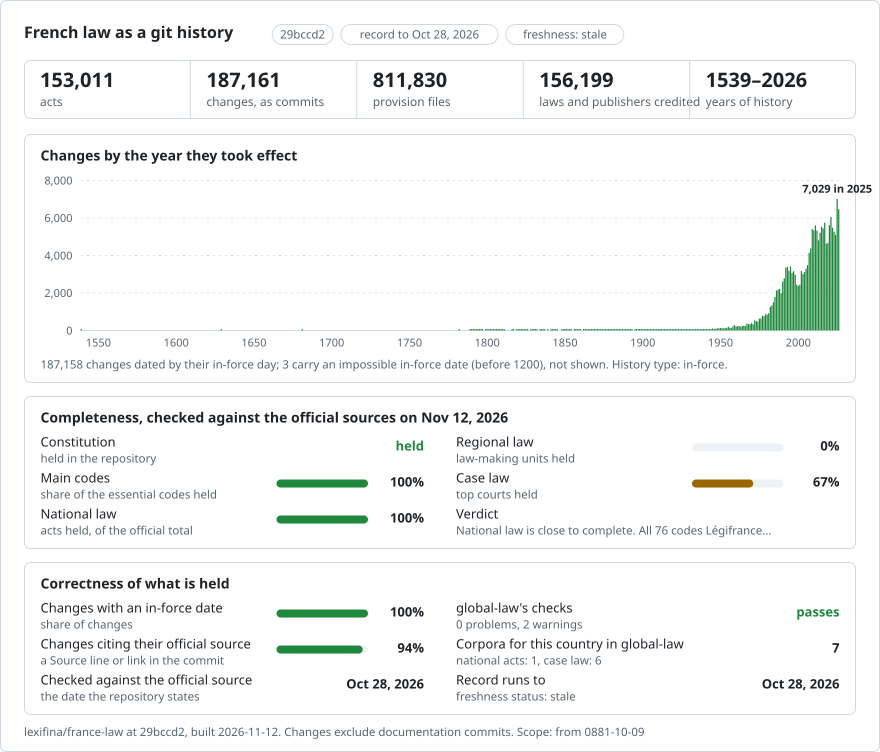

# France: law history in git

**English** · **[Ou lisez-le en français](README.md)**

<picture>
<source media="(prefers-color-scheme: dark)" srcset="data/effort-dark.svg">

</picture>

The law of France as a git history: one file per article, one commit for each text's changes on the day they took effect, and the text that made each change as the commit's author. `git blame` names the text behind every paragraph; `git log` lists every change to an article; picking a date gives the text in force that day.

Part of [lexifina/global-law](https://github.com/lexifina/global-law), one git history for every country's law: this is France's national law, which global-law reads at `france/national/acts/`.

**What is in it now:** every text that LEGI, the database behind Légifrance, consolidates, as it stood on 2026-10-28. In force that day: the Constitution of 1958 (with the articles of the 1946 and 1848 Constitutions LEGI keeps in force), 77 codes and 118,773 other texts (69,738 arrêtés, 44,755 décrets, 2,815 lois, 1,320 ordonnances and 145 others), with 692,977 articles; in the history, 1,556,213 article versions of 153,011 texts, in 187,161 commits. Each text's folder has an `index.md` with its title, numbers, dates and Légifrance link.

The Constitution is in `constitution/constitution-1958/`, each code in `codes/<code>/` (`codes/code-du-travail/` is the Code du travail) and every other text in `textes/<nature>/<year>/<nature>-<number>/` (`textes/loi/1978/loi-78-17/` is the loi Informatique et Libertés of 6 January 1978). Each article is a file named after its number: article L. 3141-1 is `L3141-1.md`. With about 810,000 files, a bare clone (`git clone --bare`) is quicker, and the git commands below work in it.

The text is in French, as LEGI publishes it. An English translation is not part of this record.

## Questions as git commands

| Question | Command |
| --- | --- |
| Every change to article L. 3141-1 of the Code du travail (paid leave) | `git log -p --word-diff -- codes/code-du-travail/L3141-1.md` |
| Which text wrote each line of article L. 3141-1? | `git blame codes/code-du-travail/L3141-1.md` |
| Every change to the Code du travail, with the day it took effect and the text that made it | `git log --format="%h %(trailers:key=In-force,valueonly,separator=) %an" -- codes/code-du-travail` |
| Article L. 3141-1 as in force on 1 January 2010 | `python tools/en_vigueur.py 2010-01-01 code-du-travail L3141-1` |

**Outside git**, we also host this record publicly, for free:

- **[Ask Claude about French law](https://global-law.lexifina.com/v1/try_claude?country=france)**: opens Claude with a first question ready.
- **[Ask ChatGPT](https://global-law.lexifina.com/v1/try_chatgpt?country=france)**: the same question in ChatGPT.
- **[Call the API in your browser](https://global-law.lexifina.com/v1/search_law?query=cong%C3%A9s+pay%C3%A9s&jurisdictions=france)**: a search of French law for "congés payés", returned as JSON. See the [documentation here](https://lexifina.com/api/global-law).

Both assistants read the record through the free Global law connector (MCP, `https://global-law.lexifina.com/mcp`); the first time, the chat gives you the link that adds it. Ask in French or in English.

**Host it yourself easily.** All it takes is git and Python, and the tools run on your machine:

```sh
git clone --depth 1 https://github.com/lexifina/global-law && cd global-law
python3 tools/countries.py add france/national/acts
python3 tools/law.py show 2026-01-01 france/national/acts/codes/code-du-travail/L3141-1.md
```

Opened in Claude Code, Cursor, VS Code or Codex, the clone also starts a local MCP server with the same tools ([MCP.md](https://github.com/lexifina/global-law/blob/main/MCP.md)).

## Dates

Each law commit is dated at noon, Europe/Paris, on the day its article versions took effect, and carries it in its `In-force:` trailer; the day the text was signed is in `Signed:`.

- The day is LEGI's own first day for each article version (DATE_DEBUT); versions LEGI marks as never in force are left out.
- An article version that ends with no successor is removed on its last day, in the commit of the text LEGI names as ending it, or else in a `Fin de vigueur` commit.
- git cannot store dates before 1970, so the 6,097 earlier commits are dated from 1970-01-01 UTC, one second apart, with the real day in `In-force:`. Ask for a date with `tools/en_vigueur.py`, not `git log --before`.
- Where LEGI's day is wrong (a mistyped year, a day before the text was signed), later commits name the version and the right day; published commits are not rewritten.

Each change is credited to the text that made it, as LEGI's links name it (`Loi n° 2016-1088 du 8 août 2016`): the linked text signed last on or before the day the version took effect. Where LEGI names none, it is credited to `Légifrance (DILA), version consolidée` (5,410 commits); [`data/credits.csv`](data/credits.csv) names the right text for versions LEGI files under the wrong one.

## How it is checked

- `tools/check_repo.py` takes a series of days and compares, file for file and byte for byte, the tree in force each day with the article versions LEGI has in force that day.
- `tools/test_repo.py` checks that blame, the dated tool and `git log --follow` work, that every law commit carries `In-force:`, and that every law commit is credited to a text, never to Lexifina.
- [`REPRODUCE.md`](REPRODUCE.md) gives every build step, with the archives' sha256 in [`data/archives.json`](data/archives.json); it says the same archives give the same commits with the same hashes. For the build of 2026-10-28 it records that neither check, nor a rebuild, was run.

## What it does not show

- **Texts LEGI does not consolidate, and versions older than LEGI's.** LEGI records each text from the version it first consolidated; its history of the oldest codes is fullest from the 1990s.
- **Section headings** (livres, titres, chapitres) and the order of a code's parts.
- **Which words an amending text changed** within an article: it is credited with the whole new version.
- **Changes after 2026-10-28**: LEGI's daily updates have been read up to that day.
- **Case law.** It is in six repositories of its own, which global-law reads beside this one ([france/](https://github.com/lexifina/global-law/tree/main/france)).

## Sources

| Source | Kind | Past versions | Notes |
| --- | --- | --- | --- |
| [LEGI](https://echanges.dila.gouv.fr/OPENDATA/LEGI/) (DILA), the data behind [Légifrance](https://www.legifrance.gouv.fr) | Consolidated national law: the Constitution, codes, lois, ordonnances, décrets, arrêtés | yes, every article version LEGI records | The full dump and its daily updates; the authentic text is the one published in the Journal officiel |

## Licence

See [`LICENSE`](LICENSE). The legal text and its history are LEGI's, reused under the Licence Ouverte 2.0 (Etalab), which asks that the source (DILA) and the date of its last update be cited; the tools and documentation are under the MIT License.

No AI model wrote or changed legal text; the builder, the tools and the documentation were written by an AI model (see [`REPRODUCE.md`](REPRODUCE.md)).

## More

From [lexifina/global-law](https://github.com/lexifina/global-law):

- [FEATURES.md](https://github.com/lexifina/global-law/blob/main/FEATURES.md): every feature, and what every corpus must support (`git blame`, `law.py`, the MCP tools)
- [FAQ.md](https://github.com/lexifina/global-law/blob/main/FAQ.md): questions and answers · [CONTRIBUTING.md](https://github.com/lexifina/global-law/blob/main/CONTRIBUTING.md): proposing changes · [MCP.md](https://github.com/lexifina/global-law/blob/main/MCP.md): the MCP server · [REPRODUCE.md](https://github.com/lexifina/global-law/blob/main/REPRODUCE.md): how it was built · [CHANGELOG.md](https://github.com/lexifina/global-law/blob/main/CHANGELOG.md)
- [FRESHNESS.md](https://github.com/lexifina/global-law/blob/main/FRESHNESS.md): how current each corpus is · [Monitoring](https://github.com/lexifina/global-law/tree/main/monitoring): whether updates are running · [WATCHING.md](https://github.com/lexifina/global-law/blob/main/WATCHING.md): how each official source is watched for changes
- [performance/](https://github.com/lexifina/global-law/tree/main/performance): how fast the tools are, measured
- [visualisations/](https://github.com/lexifina/global-law/tree/main/visualisations): charts and bridges across the world's law
- [Vulnerabilities](https://github.com/lexifina/global-law/tree/main/vulnerabilities): mistakes in legislation as published
