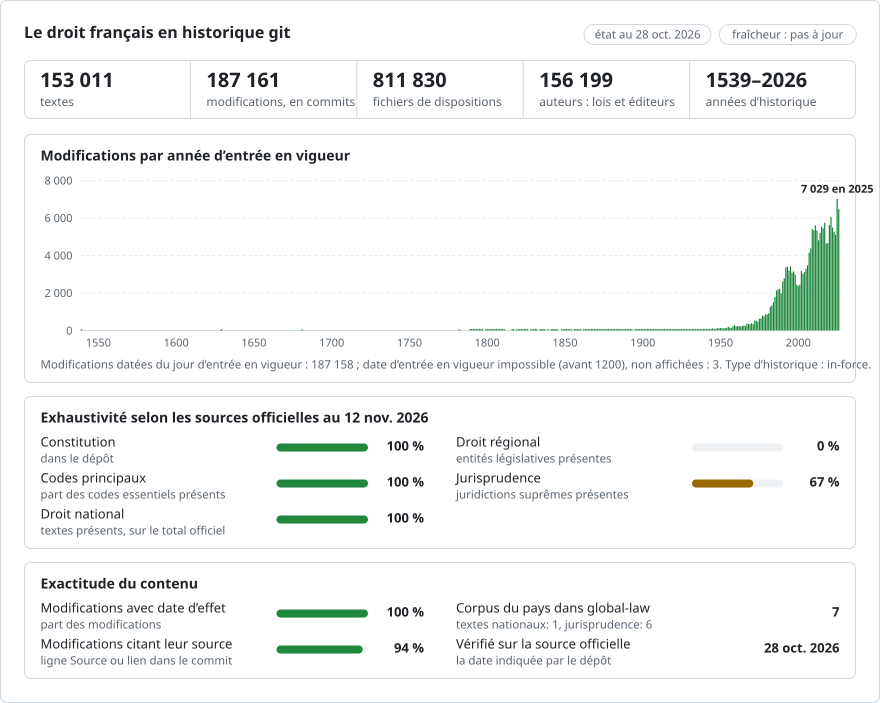

# Le droit français, modification par modification

**Français** · [English](README.en.md)

<picture>
<source media="(prefers-color-scheme: dark)" srcset="data/fr/effort-dark.svg">

</picture>

Fait partie de [lexifina/global-law](https://github.com/lexifina/global-law), un historique git unique pour le droit de chaque pays : ce dépôt contient le droit national français, que global-law lit dans `france/national/acts/`.

Tous les textes consolidés de LEGI, la base de données sur laquelle repose Légifrance, dans un seul dépôt git : la
Constitution de 1958, les codes, ainsi que les lois, ordonnances, décrets et arrêtés que LEGI consolide, un fichier par
article. Chaque commit correspond à l’entrée en vigueur d’un texte : il écrit les versions d’articles issues de ce
texte, est attribué à ce texte et est daté du jour d’entrée en vigueur de ces versions, à midi, heure de Paris. Le texte
est celui de LEGI, publié par la DILA sous Licence Ouverte 2.0.

187 161 commits de droit, du 0881-10-09 jusqu’aux données du 2026-10-28 ; 1 556 213 versions d’articles dans
153 011 textes, créées ou closes par 156 293 textes. Au dernier jour, 692 985 fichiers d’articles sont en vigueur,
dans 77 codes et 118 773 autres textes.

Le dépôt contient 692 985 fichiers d’articles ; un clone nu (`git clone --bare`) s’obtient donc plus vite, et toutes
les commandes git ci-dessous y fonctionnent. Dans un clone nu, extrayez d’abord l’outil : `git show main:tools/en_vigueur.py >
en_vigueur.py`, puis lancez-le depuis l’intérieur du clone avec `python ../en_vigueur.py …`.

## Les questions, en commandes git

| Question | Commande |
| --- | --- |
| Que disait l’article 1er de la Constitution le 1er janvier 2000 ? | `python tools/en_vigueur.py 2000-01-01 constitution-1958 1` |
| L’article 1382 du Code civil au 1er juin 2010 | `python tools/en_vigueur.py 2010-06-01 code-civil 1382` |
| Quel texte a écrit chaque alinéa de l’article 1er de la Constitution ? | `git blame main -- constitution/constitution-1958/1.md` |
| Toutes les modifications de l’article 1er, avec le texte et le jour | `git log --follow --format="%(trailers:key=In-force,valueonly,separator=) %an" main -- constitution/constitution-1958/1.md` |
| Tous les jours où la Constitution a changé | `git tag -l "constitution/*"` |
| Les dix dernières modifications du Code civil | `git log -10 --format="%(trailers:key=In-force,valueonly,separator=) %an" main -- codes/code-civil` |
| Tout ce qu’un texte a modifié : la loi constitutionnelle du 23 juillet 2008 | `git log --author="2008-724" --format="%(trailers:key=In-force,valueonly,separator=) %s" main` |
| Les versions pour lesquelles LEGI n’indique aucun texte modificateur | `git log -5 --author="Légifrance" --format="%(trailers:key=In-force,valueonly,separator=) %b" main` |
| Les articles dont la vigueur a pris fin sans successeur | `git log -5 --author="Fin de vigueur" --format="%(trailers:key=In-force,valueonly,separator=) %b" main` |
| Ce qu’est un texte, avec ses numéros et son lien Légifrance | `git show main:codes/code-civil/index.md` |

## Les dates, et celle que nous retenons

Un texte français a une date de signature (`Signed:`), une date de publication au Journal officiel et, pour chaque
version d’article qu’il crée, une date d’entrée en vigueur de cette version. **Les commits sont datés du jour d’entrée
en vigueur des versions d’articles** (DATE_DEBUT dans LEGI), à midi, heure de Paris (CET, ou CEST à l’heure d’été) :
c’est ce jour qui détermine le texte applicable. Le trailer `In-force:` porte ce jour dans chaque commit de droit. Git
ne peut pas enregistrer de dates antérieures à 1970 ; les commits plus anciens sont donc datés du 1970-01-01 UTC, à une
seconde d’intervalle dans l’ordre, et leur jour réel ne figure que dans `In-force:` et dans les tags ;
`tools/en_vigueur.py` lit le trailer.

## Ce que signifie « auteur »

L’auteur d’un commit est le texte qui a fait la modification, désigné à partir des champs de LEGI par sa nature, son
numéro et sa date de signature, par exemple `Loi constitutionnelle n° 2008-724 du 23 juillet 2008`, avec une adresse
formée de son identifiant au Journal officiel et se terminant par `@legifrance.invalid` (elle ne peut pas exister) ;
ainsi, `git blame` nomme le texte. Le committer est toujours `Lexifina`.

LEGI relie chaque version d’article aux textes qui l’ont créée, modifiée, déplacée, codifiée ou rectifiée. La
construction attribue la version au texte lié dont la signature est la plus récente à la date d’entrée en vigueur de la
version ou avant cette date. La première version d’un article sans un tel lien, dans un texte qui n’est pas un code, est
attribuée à son propre texte (les articles d’une loi sont faits par cette loi). Deux auteurs désignés par un libellé ne
sont pas des textes :

- `Légifrance (DILA), version consolidée` : LEGI ne nomme aucun texte ayant produit ces versions. Beaucoup sont les
  premières versions de codes, ou d’anciennes consolidations.
- `Fin de vigueur` : les versions d’articles qui prennent fin ce jour-là (abrogées, expirées ou annulées) sans
  successeur et sans texte que LEGI désigne comme les ayant abrogées, annulées ou y ayant mis fin. Lorsque LEGI en nomme
  un (lien ABROGE ou ABROGATION), la suppression est attribuée à ce texte.

Ni l’un ni l’autre n’est jamais attribué à une loi.

## Fichiers

- `constitution/constitution-1958/` contient la Constitution du 4 octobre 1958 ; les autres textes constitutionnels de
  LEGI se trouvent à côté.
- `codes/<code>/`, par exemple `codes/code-civil/`, contient chaque code, en vigueur ou abrogé.
- `textes/<nature>/<year>/<nature>-<number>/` contient tous les autres textes consolidés, par exemple
  `textes/loi/1978/loi-78-17/` (la loi Informatique et Libertés du 6 janvier 1978).

Chaque article est un fichier nommé d’après son numéro : `L. 1234-1` devient `L1234-1.md`. Un article sans numéro est
nommé d’après son identifiant LEGI. Si deux articles d’un même texte portent le même numéro au même moment (l’article 1er
d’une annexe à côté de celui du décret), le nom de fichier du plus récent se termine par une partie de son identifiant
LEGI. Un fichier se compose de `# Article <number>`, puis des alinéas de l’article, puis du `NOTA` de LEGI s’il y en a
un. Lorsqu’un article cesse d’être en vigueur, il est supprimé. Chaque dossier de texte contient un `index.md` avec son
titre, sa nature, son numéro, ses dates, ses identifiants et son lien Légifrance. Les intitulés de divisions (livres,
titres, chapitres) ne sont pas reproduits.

## Comment il est vérifié

`tools/check_repo.py` prend une série de jours et compare, fichier par fichier et octet par octet, l’arborescence en
vigueur ce jour-là avec les versions d’articles que LEGI donne en vigueur ce jour-là. `tools/test_repo.py` vérifie que
les commandes ci-dessus fonctionnent. Les résultats figurent dans [`REPRODUCE.md`](REPRODUCE.md).

## Ce qu’il ne montre pas

- Les textes que LEGI ne consolide pas, et les versions antérieures à celles de LEGI : LEGI enregistre chaque texte à
  partir de la version dans laquelle il a été consolidé pour la première fois. Son historique des codes les plus anciens
  est le plus complet à partir des années 1990.
- Les intitulés de divisions et l’ordre des parties d’un code.
- La partie d’un texte qu’un texte modificateur a changée, à un niveau plus fin que l’article : le texte modificateur
  est crédité de toute la nouvelle version de l’article.

Le texte consolidé est fourni à titre d’information. Le texte authentique est celui publié au Journal officiel.

## Comment il est construit

`tools/scan.py` et `tools/scan_daily.py` chargent dans SQLite les archives LEGI de la DILA (l’export complet et les
mises à jour quotidiennes, listés avec leur sha256 dans [`data/archives.json`](data/archives.json)) ; `tools/build.py`
écrit ce dépôt à partir de zéro depuis cette base. Chaque étape, les logiciels, les décisions et ce qu’a fait un modèle
d’IA sont décrits dans [`REPRODUCE.md`](REPRODUCE.md). [`corpus.json`](corpus.json) décrit le corpus pour les outils qui
lisent plusieurs de ces dépôts.

Ceci est une traduction de la version anglaise ([README.en.md](README.en.md)) ; en cas de divergence, la version anglaise fait foi.

## En savoir plus

Dans le dépôt [lexifina/global-law](https://github.com/lexifina/global-law) (pages en anglais) :

- [FEATURES.md](https://github.com/lexifina/global-law/blob/main/FEATURES.md): toutes les fonctionnalités et ce que chaque corpus doit prendre en charge (`git blame`, `law.py`, outils MCP)
- [FAQ.md](https://github.com/lexifina/global-law/blob/main/FAQ.md): questions et réponses · [CONTRIBUTING.md](https://github.com/lexifina/global-law/blob/main/CONTRIBUTING.md): proposer une modification · [MCP.md](https://github.com/lexifina/global-law/blob/main/MCP.md): serveur MCP · [REPRODUCE.md](https://github.com/lexifina/global-law/blob/main/REPRODUCE.md): comment il a été construit · [CHANGELOG.md](https://github.com/lexifina/global-law/blob/main/CHANGELOG.md)
- [FRESHNESS.md](https://github.com/lexifina/global-law/blob/main/FRESHNESS.md): à quel point chaque corpus est à jour · [Surveillance](https://github.com/lexifina/global-law/tree/main/monitoring): si les mises à jour fonctionnent · [WATCHING.md](https://github.com/lexifina/global-law/blob/main/WATCHING.md): comment chaque source officielle est surveillée pour repérer les modifications
- [performance/](https://github.com/lexifina/global-law/tree/main/performance): la rapidité des outils, mesurée
- [visualisations/](https://github.com/lexifina/global-law/tree/main/visualisations): graphiques et liens à travers le droit du monde entier
- [Vulnérabilités](https://github.com/lexifina/global-law/tree/main/vulnerabilities): erreurs dans les textes tels qu’ils ont été publiés
