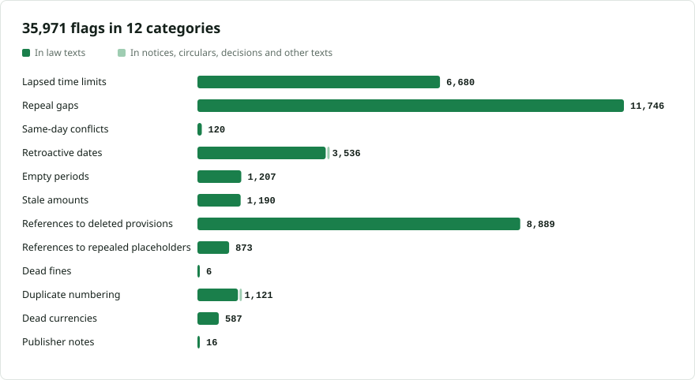

# Vulnerabilities in French law

[Français](README.md) · **English**

<picture>
<source media="(prefers-color-scheme: dark)" srcset="img/flags-by-category-dark.svg">

</picture>

The vulnerability detectors from [lexifina/global-law](https://github.com/lexifina/global-law/tree/main/vulnerabilities) look for mechanical mistakes in legislation: a rule applying "until" a date that has passed, a time limit extended only after it had run out, a provision repealed before its replacement took effect, two amendments to the same provision on the same day, a reference to an article that no longer exists. global-law's published list (9 November 2026) covered France with 25,634 flags from an earlier copy of this repository. This is a run over this repository only, as it stood at commit [`1c0156f`](https://github.com/lexifina/france-law/commit/1c0156f6d6657b89d8e2d33ea2450ac90d33f3c0) on 15 November 2026, with LEGI read up to 28 October 2026. It finds the same numbers as that list of repeal gaps (11,746), same-day conflicts (120), retroactive dates (3,536), duplicate numbers (1,121) and publisher notes (16), more lapsed time limits (6,680 against 5,939), empty periods (1,207 against 855), stale amounts (1,190 against 1,002), references to repealed placeholders (873 against 782) and dead currencies (587 against 517), and two categories that list did not have for France: references to deleted provisions (8,889) and dead fines (6).

**In short:** the detectors raised 35,971 flags. A language model reviewed 612 of the strongest, arguing each one for and against; 254 survived, 220 of them empty periods. Checked by hand in this repository, 154 of the empty periods are real: the text that moved the end date took effect after the old date had passed, with no wording reaching back that this repository shows. 146 of them have long since closed or are authorisations renewed a few days late (airline routes, approvals, visa waivers). Eight, in five rules of general application still in force, look like real drafting mistakes. The derogation letting titres-restaurant pay for any food (Article 6 of Law No. 2022-1158) ran until 31 December 2024 and was extended only from 23 January 2025. The aid for the regional and local periodical press (Article 5 of Decree No. 2004-1312) lapsed three times: from 1 January to 5 December 2019, from 1 January to 6 May 2023 and from 1 January to 9 August 2026. The control and distribution regime for energy products (Article 1 of Decree No. 92-1466) ran until 31 December 2017 and was revived only from 25 March 2022. Chapter III of the decree on the Paris gaming clubs experiment (Article 22 of Decree No. 2017-913) lapsed from 1 January 2021 to 8 November 2022 and again from 1 January to 26 February 2025, and the arrêté implementing it from 1 January 2023 to 26 February 2025. Two State guarantees that "may be granted until 31 December 2025" were extended only by the finance law for 2026, from 21 February 2026. In a category the model does not review, a new text has a reference to an article it marks as repealed: the règlement on invalidity and death insurance for the self-employed, approved by the arrêté of 1 April 2026, requires in Article 33 "the conditions laid down in Articles 36 and 37", and its Article 37 has read only "Abrogé." since the day it took effect. Of the other 66 empty periods, 45 come from how this repository records changes (changes credited to Légifrance's consolidated version, dates in Légifrance's notes, a date moved to another sentence), 19 are lawful (the date says which payments, purchases or events qualify) and in 2 the extending text applies from before the old date. Of the 34 other survivors, 6 come from how the record is built, 19 are lawful or spent, 2 cite another text's articles, 6 are the same figure in an unrelated text and 1 was misread. Later, this will be formalised in Lean, similar to our work on [the US tax code](https://lexifina.com/blog/formalizing-the-us-tax-code) and [US case law](https://lexifina.com/blog/formalizing-all-us-case-law-in-lean).

A flag is a prompt to look, not legal advice, and nothing here has been tested in court.

## Flags by category

| Category | What it looks for | Flags | In law texts | Reviewed | Survived review |
| --- | --- | ---: | ---: | ---: | ---: |
| Lapsed time limits | Text still applying a rule "until" a date that has passed | 6,680 | 6,680 | 40 | 1 |
| Repeal gaps | A provision removed before its replacement took effect | 11,746 | 11,746 | 40 | 6 |
| Same-day conflicts | Two texts changing the same provision on the same day | 120 | 120 | 40 | 6 |
| Retroactive or pre-publication dates | A rule in force before it was made or published | 3,536 | 3,532 | 40 | 6 |
| Empty periods | A time limit extended by a text that took effect after it had run out | 1,207 | 1,207 | 372 | 220 |
| Stale amounts | An amount changed in one place but still standing elsewhere | 1,190 | 1,190 | 40 | 13 |
| References to deleted provisions | A provision citing an article that no longer exists | 8,889 | 8,889 | 40 | 2 |
| References to repealed placeholders | A provision citing an article that now reads only "Abrogé" | 873 | 873 | 0 | 0 |
| Dead fines | A penalty for breaching an article that has been repealed | 6 | 6 | 0 | 0 |
| Duplicate numbering | Two units with the same number in one text | 1,121 | 1,116 | 0 | 0 |
| Dead currencies | Amounts in currencies no longer in use | 587 | 587 | 0 | 0 |
| Publisher notes | Notes that an amendment could not be carried out | 16 | 16 | 0 | 0 |

"In law texts" counts the Constitution, the codes and every text in `textes/` except notices (avis), circulars and decisions: lois, ordonnances, décrets, arrêtés, délibérations and the rest. The other flags are in the notices, circulars and decisions this repository also holds (among the decisions, a few of the Conseil d'État and the Conseil constitutionnel). Every article is a file here, so the history detectors work as designed: a repealed article is a deleted file, and an article number used again for a new article counts as a repeal gap. The commits carry the day each text was signed, so the search for retroactive dates compares it with the day each version took effect.

*Edge cases: the 254 flags that survived the review, grouped by what they turned out to be, and what the other flags are, in [EDGE-CASES.en.md](EDGE-CASES.en.md).*

## Problems found in this repository

- **Retroactive amendments credited to an older text:** a change is credited to the linked text signed last on or before the day the version took effect, so a version a later text made applicable from an earlier day goes to an older text. The version of Article L. 14-10-4 of the Code de l'action sociale et des familles in force from 1 January 2021, which a note says Law No. 2021-1754 of 23 December 2021 made applicable from that day, is [credited](https://github.com/lexifina/france-law/commit/321ddf78cf3ca8f5e3f44f2d9bcef9be8f38d65a) to Law No. 2002-2 of 2 January 2002 ([Edge cases](EDGE-CASES.en.md)).
- **Periods with no version:** where a LEGI version ends with no successor, the article is removed in a `Fin de vigueur` commit, and where LEGI's next version starts years later the article has no text in between: Article 19 of Ordinance No. 45-2138 from 1970 to 1994, Article 328 D quater of Annex III to the Code général des impôts from 1982 to 1985, with the same rule before and after.
- **HTML entities left in the text:** 478 files at the commit read still hold `&laquo;`, `&raquo;` or other HTML entities in place of the characters, for example the notes to Annexes IV and V of the arrêté of 8 June 2021 on the physical and medical fitness of gendarmes.

## Files

| File | What it holds |
| --- | --- |
| [data/flags.csv](data/flags.csv) | Every flag, one row per provision and issue |
| [data/reviewed.csv](data/reviewed.csv) | The 612 flags the model reviewed, with its verdict and reason |
| [data/by_category.csv](data/by_category.csv) | The counts in the table above |
| [tools/](tools/) | The scripts that made this run |

Columns: `category` and `category_fr` (the category in English and French), `detector`, `kind` (`law` or `other`), `path` (the article in this repository; for a retroactive date, the first file the text wrote that day), `date` (the date the flag turns on), `reference` (the text or line involved), `summary`, `score` (the detector's ranking, 0 to 1), `review` (`artefact`, `lawful` or `candidate_defect`), `survives_rebuttal`, `review_note` (the model's reason, in English), `url` (the article at the commit that was read, or, for an article repealed since, at the last commit that held it; for a retroactive date, the commit that wrote the text's version that day).

## How it was made

- **Detectors:** global-law's [vulnerabilities/scripts](https://github.com/lexifina/global-law/tree/main/vulnerabilities/scripts), with the fixes in [tools/patch_detectors.py](tools/patch_detectors.py), run on this repository at commit `1c0156f`. global-law replays this repository only up to an earlier commit, so the history table the detectors read was built from this repository's own commits (the author, that is the text that made each change, and the `In-force` and `Kind` trailers); 187,161 commits count as law.
- **Model review:** gpt-5.4-mini, the 40 strongest flags per category; the 40 strongest lapsed time limits in law texts are the same 40, since all are in law texts. One pass says whether a flag is real, a second argues that it is not. Empty periods use global-law's own review for that category, on every flag whose old and new date open the same sentence (372 of them), followed by the same second pass. The model does not review the last five categories. global-law's own list used a different model.
- **Hand check:** every case that survived was read in this repository's history and texts. For the empty periods, [tools/late_ext_check.py](tools/late_ext_check.py) checks that the extending commit replaced the old date with the new one in the same sentence and lists the extending text's own articles on when it takes effect; this repository holds a text's articles that are still in force, so for most amending texts only the article that orders publication remains, and none of the five open cases has a separate article that reaches back. The dates are LEGI's: where a text says it applies from an earlier day, LEGI usually starts the version on that day. The open cases still need the Journal officiel; Law No. 2025-56 is not in this repository at all.

To report a correction, open an issue with the provision and an official source.

## Licence

The lists and notes are Lexifina's, under the MIT License like this repository's tools and documentation. Quoted law text is LEGI's, from the Direction de l'information légale et administrative (DILA), reused under the Licence Ouverte 2.0, data last updated 28 October 2026; see [LICENSE](../LICENSE).
