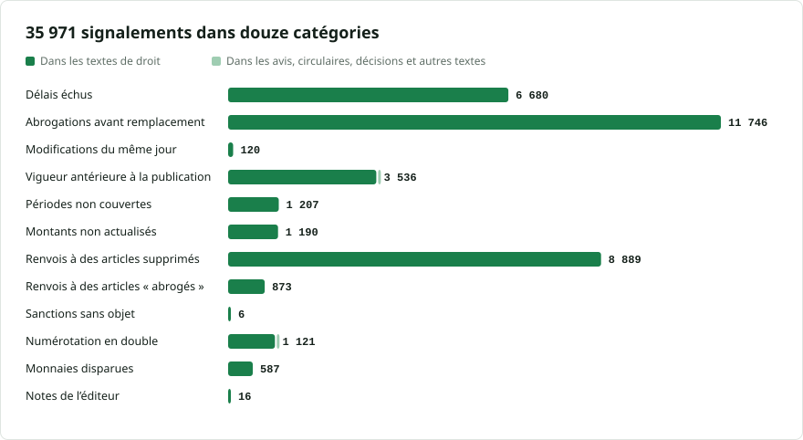

# Vulnérabilités du droit français

**Français** · [English](README.en.md)

<picture>
<source media="(prefers-color-scheme: dark)" srcset="img/flags-by-category-dark.fr.svg">

</picture>

Les détecteurs de vulnérabilités de [lexifina/global-law](https://github.com/lexifina/global-law/tree/main/vulnerabilities) recherchent les erreurs mécaniques de la législation : une règle qui s’applique encore « jusqu’au » une date déjà passée, un délai prorogé seulement après son expiration, une disposition abrogée avant l’entrée en vigueur de celle qui la remplace, deux modifications d’une même disposition le même jour, un renvoi à un article qui n’existe plus. La liste publiée par global-law le 9 novembre 2026 couvrait la France avec 25 634 signalements, tirés d’une copie antérieure de ce dépôt. Il s’agit ici d’une analyse de ce seul dépôt, dans l’état du commit [`1c0156f`](https://github.com/lexifina/france-law/commit/1c0156f6d6657b89d8e2d33ea2450ac90d33f3c0) du 15 novembre 2026, LEGI étant lu jusqu’au 28 octobre 2026. Elle trouve autant d’abrogations avant remplacement (11 746), de modifications du même jour (120), de dates de vigueur antérieures à la publication (3 536), de numéros en double (1 121) et de notes de l’éditeur (16) que cette liste, davantage de délais échus (6 680 contre 5 939), de périodes non couvertes (1 207 contre 855), de montants non actualisés (1 190 contre 1 002), de renvois à des articles « abrogés » (873 contre 782) et de monnaies disparues (587 contre 517), ainsi que deux catégories que cette liste ne comptait pas pour la France : les renvois à des dispositions supprimées (8 889) et les sanctions sans objet (6).

**En bref :** les détecteurs ont produit 35 971 signalements. Un modèle de langage a examiné les 612 plus forts, en pesant pour chacun les arguments pour et contre ; 254 ont résisté, dont 220 périodes non couvertes. Vérifiées à la main dans ce dépôt, 154 de ces périodes sont réelles : le texte qui a reporté la date a pris effet après l’échéance, sans disposition rétroactive visible dans ce dépôt. 146 sont refermées depuis longtemps ou concernent des autorisations renouvelées avec quelques jours de retard (lignes aériennes, agréments, dispenses de visa). Huit, dans cinq règles de portée générale encore en vigueur, ressemblent à de véritables erreurs. La dérogation qui permet de payer tout produit alimentaire en titres-restaurant (article 6 de la loi n° 2022-1158) courait jusqu’au 31 décembre 2024 et n’a été prorogée qu’à compter du 23 janvier 2025. L’aide au pluralisme de la presse périodique régionale et locale (article 5 du décret n° 2004-1312) est tombée trois fois : du 1er janvier au 5 décembre 2019, du 1er janvier au 6 mai 2023 et du 1er janvier au 9 août 2026. Le régime de contrôle et de répartition des produits énergétiques (article 1er du décret n° 92-1466) courait jusqu’au 31 décembre 2017 et n’a été rétabli qu’à compter du 25 mars 2022. Le chapitre III du décret relatif à l’expérimentation des clubs de jeux à Paris (article 22 du décret n° 2017-913) a cessé de s’appliquer du 1er janvier 2021 au 8 novembre 2022, puis du 1er janvier au 26 février 2025, et l’arrêté pris pour son application du 1er janvier 2023 au 26 février 2025. Deux garanties de l’État qui « peu[ven]t être accordée[s] jusqu’au 31 décembre 2025 » n’ont été prorogées que par la loi de finances pour 2026, à compter du 21 février 2026. Dans une catégorie que le modèle n’examine pas, un texte récent renvoie à un article qu’il présente lui-même comme abrogé : le règlement du régime d’assurance invalidité-décès des travailleurs indépendants, approuvé par l’arrêté du 1er avril 2026, exige en son article 33 « les conditions fixées aux articles 36 et 37 », alors que son article 37 ne porte que la mention « Abrogé. » depuis son entrée en vigueur. Sur les 66 autres périodes non couvertes, 45 tiennent à la manière dont ce dépôt enregistre les modifications (modifications attribuées à la version consolidée de Légifrance, dates figurant dans les notes de Légifrance, date déplacée dans une autre phrase), 19 sont régulières (la date désigne les versements, acquisitions ou événements concernés) et dans 2 cas le texte de prorogation s’applique depuis une date antérieure à l’échéance. Sur les 34 autres signalements retenus, 6 tiennent à la construction du dépôt, 19 sont réguliers ou épuisés, 2 visent les articles d’un autre texte, 6 sont un même chiffre dans un texte sans rapport et 1 est une erreur de lecture. Ces textes seront ensuite formalisés en Lean, comme nos travaux sur [le code des impôts des États-Unis](https://lexifina.com/blog/formalizing-the-us-tax-code) et [la jurisprudence américaine](https://lexifina.com/blog/formalizing-all-us-case-law-in-lean).

Un signalement invite à regarder de plus près ; ce n’est pas un conseil juridique, et rien de ce qui figure ici n’a été soumis à un juge.

## Signalements par catégorie

| Catégorie | Ce qu’elle recherche | Signalements | Dans les textes de droit | Examinés | Retenus après examen |
| --- | --- | ---: | ---: | ---: | ---: |
| Délais échus | Un texte qui applique encore une règle « jusqu’au » une date passée | 6 680 | 6 680 | 40 | 1 |
| Abrogations avant remplacement | Une disposition supprimée avant l’entrée en vigueur de celle qui la remplace | 11 746 | 11 746 | 40 | 6 |
| Modifications du même jour | Deux textes modifiant la même disposition le même jour | 120 | 120 | 40 | 6 |
| Vigueur antérieure à la publication | Une règle en vigueur avant d’avoir été prise ou publiée | 3 536 | 3 532 | 40 | 6 |
| Périodes non couvertes | Un délai prorogé par un texte entré en vigueur après son expiration | 1 207 | 1 207 | 372 | 220 |
| Montants non actualisés | Un montant modifié à un endroit mais maintenu ailleurs | 1 190 | 1 190 | 40 | 13 |
| Renvois à des dispositions supprimées | Une disposition qui renvoie à un article qui n’existe plus | 8 889 | 8 889 | 40 | 2 |
| Renvois à des articles « abrogés » | Une disposition qui renvoie à un article réduit à la mention « Abrogé » | 873 | 873 | 0 | 0 |
| Sanctions sans objet | Une sanction pour la méconnaissance d’un article abrogé | 6 | 6 | 0 | 0 |
| Numérotation en double | Deux subdivisions portant le même numéro dans un même texte | 1 121 | 1 116 | 0 | 0 |
| Monnaies disparues | Des montants exprimés dans une monnaie qui n’a plus cours | 587 | 587 | 0 | 0 |
| Notes de l’éditeur | Des notes indiquant qu’une modification n’a pu être faite | 16 | 16 | 0 | 0 |

« Dans les textes de droit » comprend la Constitution, les codes et tous les textes du dossier `textes/` hors avis, circulaires et décisions : lois, ordonnances, décrets, arrêtés, délibérations et autres. Les autres signalements portent sur les avis, circulaires et décisions que ce dépôt contient également (parmi les décisions, quelques-unes du Conseil d’État et du Conseil constitutionnel). Chaque article est ici un fichier, si bien que les détecteurs fondés sur l’historique fonctionnent comme prévu : un article abrogé est un fichier supprimé, et un numéro d’article réutilisé pour un nouvel article compte comme une abrogation avant remplacement. Les commits portent la date de signature de chaque texte, que la recherche des dates de vigueur antérieures compare avec la date d’entrée en vigueur de chaque version.

*Cas limites : les 254 signalements retenus après examen, regroupés selon ce qu’ils se sont révélés être, et la nature des autres signalements, dans [EDGE-CASES.md](EDGE-CASES.md).*

## Problèmes relevés dans ce dépôt

- **Modifications rétroactives attribuées à un texte plus ancien :** une modification est attribuée au texte lié signé en dernier au plus tard le jour d’entrée en vigueur de la version, de sorte qu’une version qu’un texte postérieur a rendue applicable à une date antérieure revient à un texte plus ancien. La version de l’article L. 14-10-4 du code de l’action sociale et des familles en vigueur au 1er janvier 2021, qu’une note dit rendue applicable à cette date par la loi n° 2021-1754 du 23 décembre 2021, est [attribuée](https://github.com/lexifina/france-law/commit/321ddf78cf3ca8f5e3f44f2d9bcef9be8f38d65a) à la loi n° 2002-2 du 2 janvier 2002 ([cas limites](EDGE-CASES.md)).
- **Périodes sans version :** lorsqu’une version de LEGI prend fin sans successeur, l’article est supprimé dans un commit `Fin de vigueur`, et lorsque la version suivante de LEGI ne commence que des années plus tard, l’article n’a aucun texte dans l’intervalle : l’article 19 de l’ordonnance n° 45-2138 de 1970 à 1994, l’article 328 D quater de l’annexe III au code général des impôts de 1982 à 1985, avec la même règle avant et après.
- **Entités HTML restées dans le texte :** 478 fichiers du commit examiné contiennent encore `&laquo;`, `&raquo;` ou d’autres entités HTML à la place des caractères, par exemple les notes des annexes IV et V de l’arrêté du 8 juin 2021 fixant les conditions physiques et médicales d’aptitude des militaires de la gendarmerie.

## Fichiers

| Fichier | Contenu |
| --- | --- |
| [data/flags.csv](data/flags.csv) | Tous les signalements, une ligne par disposition et par problème |
| [data/reviewed.csv](data/reviewed.csv) | Les 612 signalements examinés par le modèle, avec son avis et sa motivation |
| [data/by_category.csv](data/by_category.csv) | Les chiffres du tableau ci-dessus |
| [tools/](tools/) | Les scripts qui ont produit cette analyse |

Colonnes : `category` et `category_fr` (la catégorie en anglais et en français), `detector`, `kind` (`law` ou `other`), `path` (l’article dans ce dépôt ; pour une date de vigueur antérieure, le premier fichier écrit ce jour-là par le texte), `date` (la date sur laquelle porte le signalement), `reference` (le texte ou la ligne en cause), `summary`, `score` (le classement du détecteur, de 0 à 1), `review` (`artefact`, `lawful` ou `candidate_defect`), `survives_rebuttal`, `review_note` (la motivation du modèle, en anglais), `url` (l’article dans le commit examiné ou, pour un article abrogé depuis, dans le dernier commit qui le contenait ; pour une date de vigueur antérieure, le commit qui a écrit la version du texte ce jour-là).

## Méthode

- **Détecteurs :** les [vulnerabilities/scripts](https://github.com/lexifina/global-law/tree/main/vulnerabilities/scripts) de global-law, avec les corrections de [tools/patch_detectors.py](tools/patch_detectors.py), exécutés sur ce dépôt au commit `1c0156f`. global-law ne rejoue ce dépôt que jusqu’à un commit antérieur ; la table d’historique lue par les détecteurs a donc été construite à partir des commits de ce dépôt (l’auteur, c’est-à-dire le texte auteur de chaque modification, et les trailers `In-force` et `Kind`) ; 187 161 commits comptent comme du droit.
- **Examen par le modèle :** gpt-5.4-mini, sur les 40 signalements les plus forts de chaque catégorie ; les 40 délais échus les plus forts dans les textes de droit sont les mêmes, tous figurant dans des textes de droit. Un premier passage dit si le signalement est fondé, un second plaide le contraire. Les périodes non couvertes passent par l’examen propre de global-law pour cette catégorie, sur tous les signalements dont l’ancienne et la nouvelle date ouvrent la même phrase (372), suivi du même second passage. Le modèle n’examine pas les cinq dernières catégories. La liste de global-law a été établie avec un autre modèle.
- **Vérification manuelle :** chaque cas retenu a été lu dans l’historique et les textes de ce dépôt. Pour les périodes non couvertes, [tools/late_ext_check.py](tools/late_ext_check.py) vérifie que le commit de prorogation a remplacé l’ancienne date par la nouvelle dans la même phrase et relève les articles du texte de prorogation qui fixent sa date d’effet ; ce dépôt ne contient que les articles encore en vigueur de chaque texte, si bien que, pour la plupart des textes modificatifs, seul subsiste l’article d’exécution, et aucun des cinq cas ouverts ne comporte d’article distinct à effet rétroactif. Les dates sont celles de LEGI : lorsqu’un texte prévoit son application à une date antérieure, LEGI fait en général commencer la version à cette date. Les cas ouverts demandent encore le Journal officiel ; la loi n° 2025-56 ne figure pas dans ce dépôt.

Pour signaler une correction, ouvrez une issue indiquant la disposition et une source officielle.

## Licence

Les listes et les notes appartiennent à Lexifina et relèvent de la licence MIT, comme les outils et la documentation de ce dépôt. Le texte juridique cité est celui de LEGI, publié par la Direction de l’information légale et administrative (DILA), réutilisé sous la Licence Ouverte 2.0, données mises à jour pour la dernière fois le 28 octobre 2026 ; voir [LICENSE](../LICENSE).
